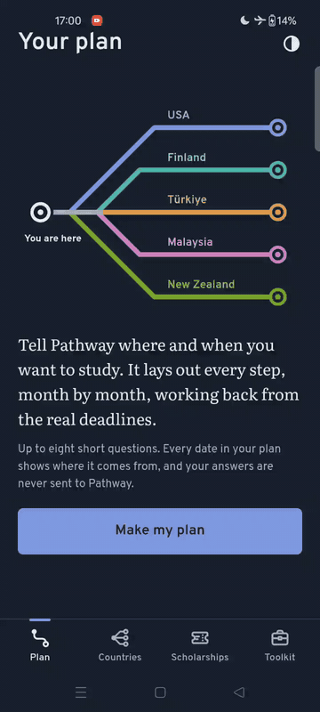
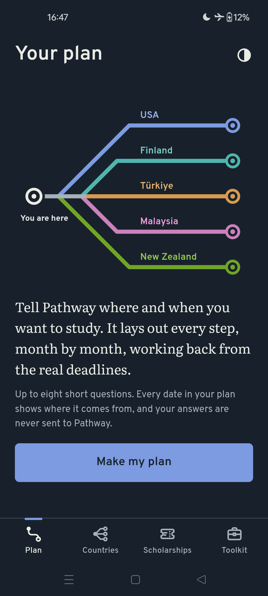
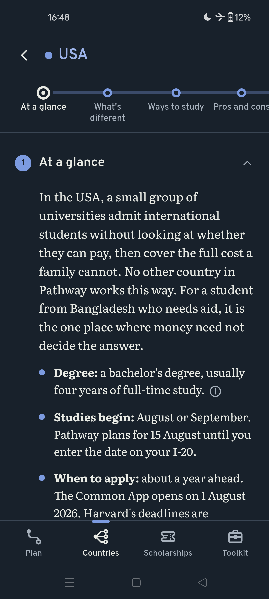
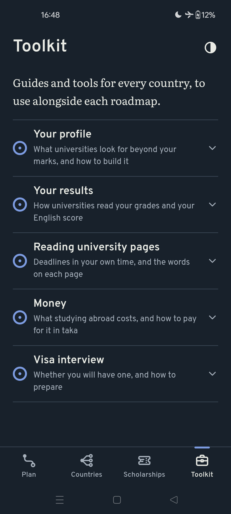
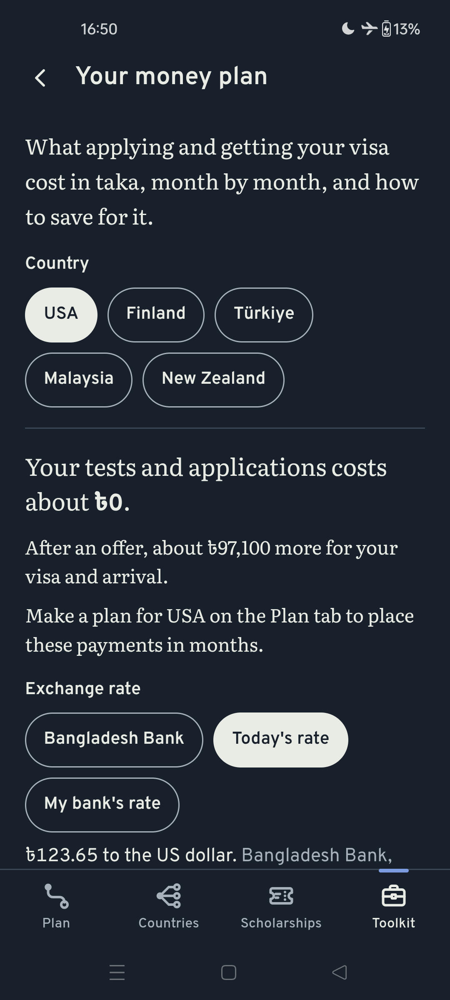

# Pathway

A study-abroad planner for students in Bangladesh that turns a few answers into a dated, month-by-month plan for the USA, Finland, Türkiye, Malaysia or New Zealand, with every date and figure traced back to its official source.

<p align="center">
  
</p>

[](https://github.com/saminsiddiqui08-beep/pathway/releases/latest)

## Quick Start

**[Download the latest APK here](https://github.com/saminsiddiqui08-beep/pathway/releases/latest)**

Pathway is an Android app, installed from its APK file rather than the Play Store:

1. On your Android phone, open the link above and download `Pathway-1.0.apk` from the release's Assets. If the browser warns that this type of file can harm your device, choose **Download anyway**.
2. Open the downloaded file. If Android asks, allow your browser or Files app to install unknown apps.
3. If Google Play Protect warns that the developer is unknown, choose **More details**, then **Install anyway**.
4. Open Pathway, choose a country, and answer up to eight short questions. Nothing to sign up for, and everything except today's exchange rate works offline.

On phones in Brazil, Indonesia, Singapore and Thailand, Android may ask for its extra install steps for apps from developers who have not registered with Google. The app itself is the same.

## Requirements

- **Platform:** Android only.
- **Minimum version:** Android 7.0 (API level 24).
- **Also needed:** Android System WebView 98 or newer, the part of Android that draws the app's screens. The Play Store keeps it up to date on its own.
- **Tested on:** a OnePlus 9R at 120 Hz, in both light and dark themes.

## Screenshots

<p align="center">
  
  
  
  
</p>

## Features

- **Rule-Based Timeline Generator:** Building a month-by-month route from the student's school system and year, intake, English test, SAT, aid needs and passport, then marking every step with its date, its reason, and where that date comes from. When an intake can no longer be reached, the plan says which chain of steps makes it late and offers the next one that fits. Optional reminders arrive a week before each step and the day before each hard deadline, as notifications made on the phone itself.
- **Five Country Roadmaps:** Covering the USA, Finland, Türkiye, Malaysia and New Zealand in seventeen sections each, from the routes that make each country different to visas, money, life there and common scams, with document checklists, a personal shortlist of universities, and links into the tools that fit each section.
- **Grade and English Score Checks:** Reading HSC and A level results the way named universities publish them, and placing an IELTS, TOEFL, PTE or Duolingo score on the other tests' scales with each test owner's own table. Verdicts compare the student's real results with each university's own rule, and scores that cannot appear on one report are caught before any verdict is shown.
- **Money Plan in Taka:** Adding up test fees, application fees and visa costs, minus any fee waivers, on the months of the student's plan, at Bangladesh Bank's rate, today's rate, or the student's own bank rate, with a saving plan and a "what if the taka falls" view.
- **Offline Deadline Converter:** Turning any university deadline into Dhaka time from the phone's own time zone data, including clock changes in the week of the deadline and the ambiguity of "midnight".
- **Plain-Language Guides:** Explaining 58 application and visa terms, what universities look for beyond marks, the national olympiads with a route from Bangladesh, research for school students, what a year abroad really costs, and the visa interview with eighteen practice questions.
- **Scholarship List:** Opening with seventeen US universities known for generous aid to international students, grouped by whether asking for aid can affect admission, each line resting on the university's own page.

## Local Setup

Requires Node 22 or newer, JDK 21 and the Android SDK with API level 36, with `JAVA_HOME` and `ANDROID_HOME` pointing to them.

1. Clone the repository and install the pinned dependencies:

```
git clone https://github.com/saminsiddiqui08-beep/pathway.git
cd pathway
npm ci
```

2. Check the code, the facts and the planner. The test suite runs 2,149 checks and takes about a minute:

```
npm run lint
npm run validate
npm test
```

3. Build and install on a connected phone with USB debugging enabled:

```
npx cap run android
```

## Architecture

Every date Pathway plans comes from a rules engine. Each step has a duration, the steps it waits for, and sometimes a hard deadline, and the engine runs the critical path method over them: a backward pass from the deadlines gives each step's latest start, and a forward pass from today gives its earliest finish. Each route is planned twice. The shortest run, with no comfort margins, decides whether an intake can still be reached; the planned run gives the calm dates the student actually sees. Keeping the two apart means Pathway never calls an intake impossible because of its own padding. The engine is pure JavaScript with no screen code, so 1,777 checks run it in Node against the real plan files, including a sweep through 67,296 combinations of answers. Dates are stored as whole calendar days and never parsed through `Date` strings, which removes a whole class of time zone bugs.

The facts live in six JSON files: 567 facts holding 770 values, each marked confirmed, reported or expected, with its source, where on that page to look, and the date it was checked. A confirmed fact must come from the official source itself. Roadmaps, guides and tools never type a figure. They insert it from the facts, and the validators refuse any typed amount that no cited fact holds, so a corrected fee reaches every screen at once. The facts validator exists twice, as a Node port and as the original Python reference, and both are run on 75 deliberately broken copies of the data to show that they catch every fault and agree line for line.

Roadmaps are content data drawn by one renderer rather than hand-built pages, so a new country needs only new data files. Each tool is a separate module loaded only when it is first opened, which keeps startup unchanged however many tools the Toolkit holds. The English score check applies each test owner's published rule before comparing anything: IELTS and the new TOEFL average four sections to the nearest half band, the old TOEFL adds them up, a new TOEFL report prints the middle of its band's range on the 0 to 120 scale, and Duolingo's overall is the average of its four subscores, rounded up to the next multiple of 5.

Opening and closing a section uncovers it with a `clip-path` while everything below glides on a `transform`, both of which the WebView runs off the main thread. A tap in the middle of a movement turns it around from what is on screen instead of restarting it. Android's "Remove animations" setting is followed live through a small hook in `MainActivity`, without restarting the app.

The front end is vanilla HTML, CSS and ES modules with no framework and no build step, wrapped for Android by Capacitor 8. Answers are saved on the phone with a version number, so every later update can carry them forward, and they are never sent to a server.

## Permissions

Only one permission ever shows a question: on Android 13 and newer, Pathway asks to send notifications when you turn reminders on. Android grants the others at install without asking.

| Permission | Why Pathway needs it |
|---|---|
| `INTERNET` | Only for "Today's rate" in the money plan, which fetches the day's exchange rates. Everything else works offline, and no personal data is sent. |
| `POST_NOTIFICATIONS` | Showing the plan reminders you turn on. Reminders stay off until you do. |
| `RECEIVE_BOOT_COMPLETED` | Setting the reminders again after the phone restarts, because Android forgets them. |
| `WAKE_LOCK` | Letting a reminder arrive while the phone is asleep. |
| `VIBRATE` | One light vibration when a step is marked as done. |

The notifications library also asks for exact alarms, which Pathway removes, because its reminders do not need to arrive to the minute. Android's AndroidX library adds a permission named `com.universityadmissioninfo.pathway.DYNAMIC_RECEIVER_NOT_EXPORTED_PERMISSION`, which only lets Pathway's own parts talk to each other. It gives the app no access to anything else on the phone.

## Credits

- Built with [Capacitor](https://capacitorjs.com/).
- Exchange rates by [Exchange Rate API](https://www.exchangerate-api.com).
- Fonts: [Overpass](https://fonts.google.com/specimen/Overpass), [Literata](https://fonts.google.com/specimen/Literata), and the Taka sign from [Noto Sans Bengali](https://fonts.google.com/noto/specimen/Noto+Sans+Bengali), all under the SIL Open Font License.
- Every fact is credited to its source inside the app, through the information button beside it.
